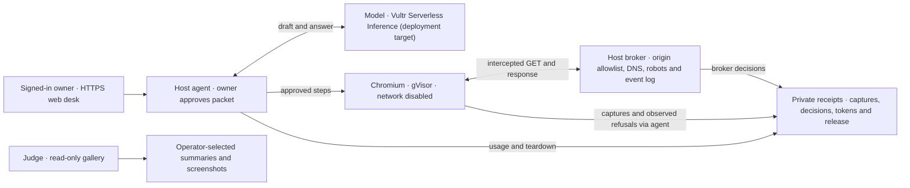

# HireZero Engine

A product marketer can check what a product page actually promises before drafting copy. Give the browser agent a question and a public site. Review the proposed steps, origin and limits, then approve the packet by its digest. Compare the answer with the captured page and inspect the network decisions and teardown. A signed-out judge can explore selected runs. [Web desk](src/HireZero.Engine.Web/) · [Agent](src/HireZero.Agent/BrowserTask.cs)



### What enforces the boundary?

| Question | Enforcement and proof |
| --- | --- |
| Can page text change the itinerary? | The agent validates the draft before approval. The answer request contains captured text and has no tools. Tests inject a navigation instruction, try an unapproved origin, a private address, `file:` and `javascript:`, and try to spend an approval twice. [Agent scope tests](tests/HireZero.Engine.Tests/BrowserTaskTests.cs) |
| Can the browser call another site? | Chromium runs with `--network none` and checks the origin before asking the broker. The broker independently checks the origin, public address, GET method, crawl policy and budgets. The receipt separates worker-observed off-site origins from broker refusals. [Driver](runtime/browser/driver.mjs) · [Broker](src/HireZero.Integrations.Web/PublicBrowserNetwork.cs) · [Refusal tests](tests/HireZero.Engine.Tests/BrowserNetworkLogTests.cs) |
| What gets into the sandbox? | The container has a read-only root, no host credentials or bind mounts, 512 MiB, one CPU and a 128-process cap. Each browser packet has a deadline of at most 120 seconds. Tests inspect the actual arguments constructed for Docker and look for a planted credential in the worker input. [Containment tests](tests/HireZero.Engine.Tests/BrowserContainmentTests.cs) · [Packet limits](src/HireZero.Core/Browser.cs) |
| What survives a run? | The runner writes the execution and JPEGs, records release, then requests an answer if it has text. The real-image qualification checks bounded capture, recovery, timeout, cancellation and removal on the specific engine. [Run sequence](src/HireZero.Agent/BrowserTask.cs) · [Real-image test](tests/HireZero.Engine.Tests/BrowserRuntimeTests.cs) |

**Observed locally on November 4.** A model-drafted HireZero homepage task captured the product's claims in 14.429 s, with ten allowed requests and 2,575 OpenRouter tokens. A second, web-approved task on Choose a License identified the MIT License in the captured page. Chromium refused Google Fonts before the broker. The broker separately refused the favicon. That browser took 10.899 s, and the answer used 617 tokens. Both runs finished with zero labeled browser containers. [HireZero run](docs/history/2026-11-04-local-browser-run.md) · [Choose a License run](docs/history/2026-11-04-web-browser-run.md)

### Quickstart

Start the [local web rehearsal](deploy/vultr/web.md#local-demo) to try the full owner flow with fictional data and no model charges. For judges, run [gallery mode](deploy/vultr/web.md#public-gallery) under a separate account with access only to operator-selected summaries and screenshots. The owner worker is the only web process with execution authority. [HTTP boundary tests](tests/HireZero.Engine.Tests/WebAppTests.cs)

With the pinned .NET SDK and Node installed, run the offline checks from the repo root. The opt-in runtime tests require a separately qualified host. [SDK](global.json) · [Tests](tests/)

```sh
dotnet test --solution HireZero.Engine.slnx
node --test tests/*.test.mjs
```

For a real browser task, use the [host setup and qualification runbook](deploy/vultr/README.md). Set the provider key and qualification receipt in the host environment and choose an absolute private `DEMO_RUNS` directory outside the checkout. The command drafts first and waits for you to type eight digest characters before starting Chromium. [Environment settings](.env.example) · [Runner options](tools/HireZero.Engine.Run/Program.cs)

```sh
dotnet run --project tools/HireZero.Engine.Run -- --goal "What does HireZero help a user do?" --site https://hirezero.app --runs "$DEMO_RUNS"
```

**Script runtime (stretch).** The same CLI accepts `--script --goal "Calculate the first ten triangular numbers"` instead of a site. The model drafts JavaScript. The owner reviews the full packet before approving its digest. Tests with fakes cover one execution, saved output, release and refusal to replay after an uncertain outcome. Real-image script qualification on Vultr is pending. [Script command and required settings](tools/HireZero.Engine.Run/ScriptCommand.cs) · [Offline tests](tests/HireZero.Engine.Tests/ScriptTaskTests.cs)

### What came from HireZero

The [original import](https://github.com/raydeStar/hirezero-engine/commit/0b9c5532bd23352d1e4e00482a74143f6ac97021) brought the pinned [browser](runtime/browser/) and [script](runtime/sandbox/) workers, [Docker adapters](src/HireZero.Integrations.Sandbox/), public-web broker and their qualification history. The [October local script checks](docs/history/2026-10-27-script-task-accounting-correction.md) apply to the recorded host and image.

### Built during Agent Rush · November 3–8, 2026

The event branch adds the [browser agent](src/HireZero.Agent/BrowserTask.cs), [broker event log](src/HireZero.Integrations.Web/BrowserNetworkLog.cs), [inference client and budgets](src/HireZero.Integrations.Inference/), [owner desk and judge gallery](src/HireZero.Engine.Web/) and [VM tooling](deploy/vultr/README.md). The target is one Vultr Cloud Compute VM serving HTTPS and orchestrating the sandbox, with all agent model calls through Vultr Serverless Inference. The [Ubuntu bootstrap dry run](docs/history/2026-11-04-bootstrap-dry-run.md) and the two local WSL/OpenRouter runs are complete. Actual Vultr hosting, inference and a public demo URL are pending credits. [Hosted web setup](deploy/vultr/web.md) · [Competition audit](docs/history/2026-11-04-competition-audit.md) · [Submission draft](docs/submission.md)

[MIT license](LICENSE) · [Third-party notices](THIRD_PARTY_NOTICES.md)
