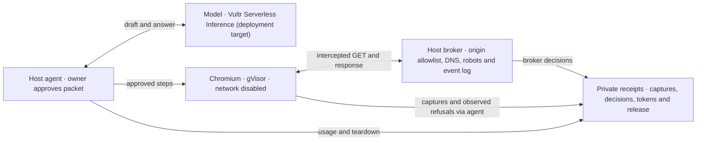

# HireZero Engine

Give the browser agent a question and a public site. It shows the sites, steps and limits it wants to use. Approve the packet by its digest and the runner returns a capture, an answer grounded in the captured text, and a receipt you can inspect. [Agent](src/HireZero.Agent/BrowserTask.cs) · [Terminal runner](tools/HireZero.Engine.Run/Program.cs)



### What enforces the boundary?

| Question | Enforcement and proof |
| --- | --- |
| Can page text change the itinerary? | The agent validates the draft before approval. The answer request contains captured text and has no tools. Tests inject a navigation instruction, try an unapproved origin, a private address, `file:` and `javascript:`, and try to spend an approval twice. [Agent scope tests](tests/HireZero.Engine.Tests/BrowserTaskTests.cs) |
| Can the browser call another site? | Chromium runs with `--network none` and checks the origin before asking the broker. The broker independently checks the origin, public address, GET method, crawl policy and budgets. The receipt separates worker-observed off-site origins from broker refusals. [Driver](runtime/browser/driver.mjs) · [Broker](src/HireZero.Integrations.Web/PublicBrowserNetwork.cs) · [Refusal tests](tests/HireZero.Engine.Tests/BrowserNetworkLogTests.cs) |
| What gets into the sandbox? | The container has a read-only root, no host credentials or mounts, 512 MiB, one CPU and a 128-process cap. Each browser packet has a deadline of at most 120 seconds. Tests inspect the actual arguments constructed for Docker and look for a planted credential in the worker input. [Containment tests](tests/HireZero.Engine.Tests/BrowserContainmentTests.cs) · [Packet limits](src/HireZero.Core/Browser.cs) |
| What survives a run? | The runner writes the execution and JPEGs, records release, then requests an answer if it has text. The real-image qualification checks bounded capture, recovery, timeout, cancellation and removal on the specific engine. [Run sequence](src/HireZero.Agent/BrowserTask.cs) · [Real-image test](tests/HireZero.Engine.Tests/BrowserRuntimeTests.cs) |

**Observed locally on November 4.** A newly qualified gVisor browser read the HireZero homepage in 14.429 seconds. The owner-approved run produced a JPEG and an answer, used 2,575 OpenRouter tokens, and left zero labeled browser containers. The broker allowed ten requests and refused none. [Run summary](docs/history/2026-11-04-local-browser-run.md)

### Quickstart

With the pinned .NET SDK and Node installed, run the offline checks from the repo root. The opt-in runtime tests require a separately qualified host. [SDK](global.json) · [Tests](tests/)

```sh
dotnet test --solution HireZero.Engine.slnx
node --test tests/*.test.mjs
```

For a real browser task, use the [host setup and qualification runbook](deploy/vultr/README.md). Set the provider key and qualification receipt in the host environment and choose an absolute private `DEMO_RUNS` directory outside the checkout. The command drafts first and waits for you to type eight digest characters before starting Chromium. [Environment settings](.env.example) · [Runner options](tools/HireZero.Engine.Run/Program.cs)

```sh
dotnet run --project tools/HireZero.Engine.Run -- --goal "What does HireZero help a user do?" --site https://hirezero.app --runs "$DEMO_RUNS"
```

### What came from HireZero

The [original import](https://github.com/raydeStar/hirezero-engine/commit/0b9c5532bd23352d1e4e00482a74143f6ac97021) brought the pinned [browser](runtime/browser/) and [script](runtime/sandbox/) workers, [Docker adapters](src/HireZero.Integrations.Sandbox/), public-web broker and their qualification history. The [October local script checks](docs/history/2026-10-27-script-task-accounting-correction.md) apply to the recorded host and image.

### Built during Agent Rush · November 3–8, 2026

The event branch adds the [browser agent](src/HireZero.Agent/BrowserTask.cs), [broker event log](src/HireZero.Integrations.Web/BrowserNetworkLog.cs), [inference client and run/month token limits](src/HireZero.Integrations.Inference/), and [disposable VM scripts](deploy/vultr/README.md). Vultr is the configured deployment provider. OpenRouter serves as the local stand-in. The [Ubuntu dry run](docs/history/2026-11-04-bootstrap-dry-run.md) verifies downloads and package simulation. Hosted VM, Vultr inference and HTTPS web-app evidence are pending. [Web design](docs/history/2026-11-04-web-proposal.md) · [Demo script](docs/demo-script.md) · [Submission draft](docs/submission.md)

[MIT license](LICENSE) · [Third-party notices](THIRD_PARTY_NOTICES.md)
